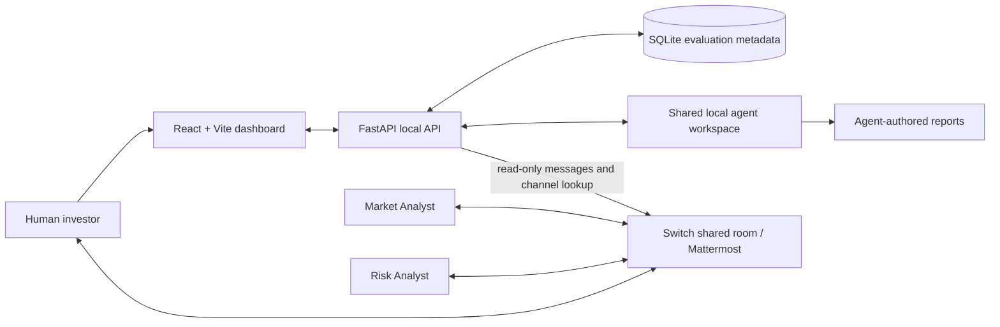

# VentureLens AI

VentureLens AI is a local-first diligence workspace that helps investors review startups with a Market Analyst, an independent Risk Analyst, and a human investor working together. It brings evaluation inputs, agent-authored research, live team-room activity, financial scenarios, and the final investment memo into one readable interface.

> LedgerLeaf and the associated metrics shown in the included demonstration are fictional. Founder-provided figures are claims until independently evidenced. VentureLens supports human review; it does not make investment decisions.

## Problem

Early-stage diligence is spread across pitch materials, research notes, spreadsheets, and conversations. A single reviewer can miss assumptions or overlook evidence gaps, while agent outputs are difficult to follow when they live in separate tools.

## Solution

VentureLens keeps the startup record and reports in a local workspace and connects them to a shared Switch team room. Specialized agents contribute market research and independent risk challenge. The human investor can follow the discussion, inspect evidence labels, test financial assumptions, and make the final decision.

## Key features

- Create and track startup evaluations, briefs, and uploaded pitch materials.
- Read Market Analysis, Independent Risk Review, and Final Investment Memo files from the shared workspace.
- View Mattermost room messages with author, timestamp, thread context, filters, and connection status.
- See diligence progress based on saved reports and observed room activity; unavailable evidence stays Pending or Unknown.
- Explore editable financial scenarios and 36-month customer projections without changing original founder inputs.
- Review a memo-derived preliminary recommendation with risks, financial indicators, evidence quality, and outstanding diligence questions.
- Print the final memo and use the browser dialog to save a branded, paginated PDF. Markdown downloads remain available.
- Store evaluation metadata in local SQLite; keep source reports and startup materials in the configured local workspace.

## Architecture



The dashboard uses FastAPI for local evaluation APIs, workspace report access, and Mattermost synchronization. Switch is central to the solution: it provides the shared team communication environment where specialized AI agents and a human investor collaborate, challenge assumptions, and leave an auditable discussion. VentureLens reads Mattermost content and never posts, edits, deletes, or manages channels.

## Technology stack

- Frontend: React, Vite, JavaScript, CSS, Lucide icons, and the existing SVG-based financial visualizations.
- Backend: Python, FastAPI, Pydantic, SQLite, Uvicorn.
- Agent collaboration: Switch with Codex agents and a Mattermost channel.
- Local report and pitch files: Markdown and supported document formats in the shared workspace.

## Windows installation

### Requirements

- Windows 10 or 11
- Python 3.11 or newer
- Node.js 20 or newer with npm
- Existing Switch/Mattermost setup and configured Codex agents for live agent collaboration

Keep the application source and agent workspace in separate directories. The backend `.env` should point `VENTURELENS_AGENT_WORKSPACE` to the directory your Switch agents use, for example:

```dotenv
VENTURELENS_AGENT_WORKSPACE=C:\Users\YOUR_WINDOWS_USER\VentureLensAI
```

### Start the application

In PowerShell, open the application directory and run:

```powershell
Set-ExecutionPolicy -Scope Process Bypass
.\start-venturelens.ps1
```

The starter prepares the local environment and launches the frontend and API. Open [http://127.0.0.1:5173](http://127.0.0.1:5173) if the browser does not open automatically. The API is at [http://127.0.0.1:8000](http://127.0.0.1:8000) and its interactive docs are at [http://127.0.0.1:8000/docs](http://127.0.0.1:8000/docs).

For a manual start, use separate PowerShell windows:

```powershell
cd .\backend
py -3 -m venv .venv
.\.venv\Scripts\Activate.ps1
python -m pip install -r requirements.txt
python -m uvicorn app.main:app --reload --host 127.0.0.1 --port 8000
```

```powershell
cd .\frontend
npm install
npm run dev
```

## Switch and Mattermost setup

The two configured Codex agents are `market-analyst` and `risk-analyst`. They use the same agent workspace for briefs and reports and collaborate with the investor in `venturelens-diligence` through Switch/Mattermost. The dashboard can prepare a diligence prompt for manual handoff, reads saved reports, and synchronizes room messages without changing Mattermost content.

For the local Mattermost instance, open **Settings → Mattermost connection**, confirm `http://127.0.0.1:55041` and the username, then enter the password and save. Use **Test read-only connection** to verify the session and room access. Username/password session authentication is preferred; a Personal Access Token can be used as an optional fallback. Passwords are stored only by the backend, and session tokens are kept server-side. Avoid committing `.env`, local database, or credentials.

## Demo workflow

1. Start the app and select the fictional LedgerLeaf evaluation.
2. On Overview, show the current recommendation, financial indicators, risks, and diligence questions.
3. Open **Financial analysis** to edit illustrative assumptions and compare 36-month customer scenarios.
4. Open **Agent room** to show actual synchronized messages, authors, timestamps, filters, connection status, and report-derived research progress.
5. In **Reports**, inspect the final memo and its evidence classifications. Choose **Export PDF**, then select **Save as PDF** in the browser print dialog.
6. Return to the Markdown **Download** action to show that the original export remains available.

## Screenshots

Add current screenshots in `docs/screenshots/` before packaging the demo:

- ``
- ``
- ``
- ``

## Privacy and security

- The app is designed for a local workspace. Evaluation metadata is stored in local SQLite; startup inputs and reports stay in the configured agent workspace.
- Mattermost credentials are submitted to the local API and retained on the backend. Session tokens and authorization headers are not sent back to the browser or logged.
- Mattermost integration is read-only: it authenticates, checks the user session, resolves the configured channel, and reads messages. It does not post, edit, delete, or manage channels.
- Do not commit secrets, local databases, or real founder material. The bundled LedgerLeaf demonstration is fictional and not verified company data.
- Evidence labels distinguish founder-provided claims, independently sourced information, estimates, and unknowns. Scenario assumptions are illustrative, not forecasts or investment advice.
